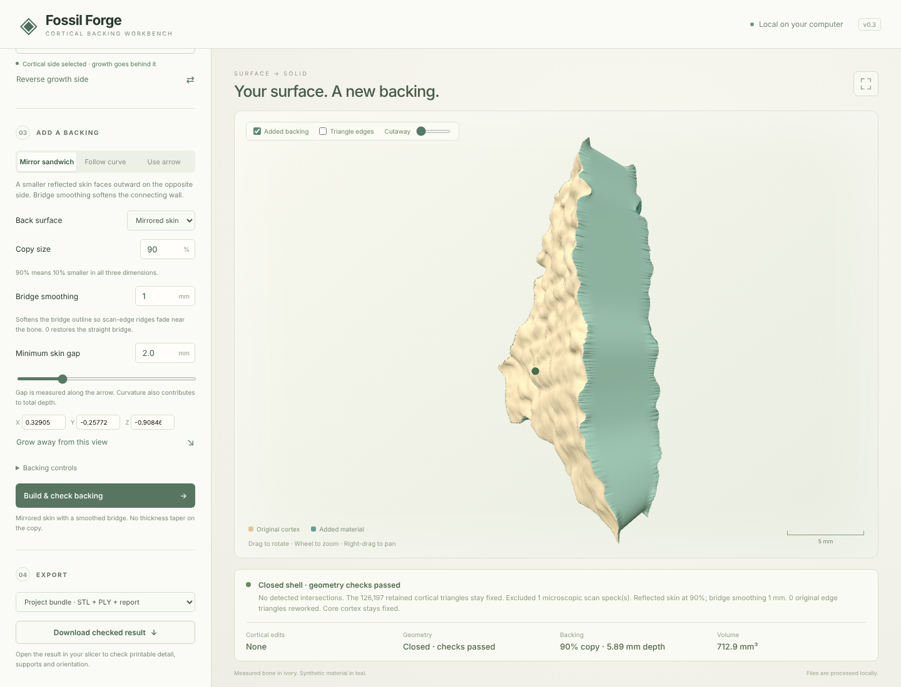

# Fossil Forge

**Turn a thin, open fossil scan into a printable solid without touching the measured surface.**

[](https://github.com/gbravomorante/fossil-forge/actions/workflows/tests.yml)


Surface scans of cortical bone fragments are open sheets: they have no thickness and cannot be
3D printed. Fossil Forge adds a synthetic backing behind the sheet, checks the resulting shell,
and exports it only once every check passes. The original cortex (every vertex and every
triangle of the scan) stays exactly as measured.



<sub>The included `examples/Example.ply` fragment after a mirror-sandwich backing: measured
cortex in ivory, added material in teal.</sub>

## How it works

1. **Load** a PLY, STL or OBJ surface and confirm its units.
2. **Choose the cortical side** with one click on the surface. An arrow shows where material
   will be added.
3. **Add a backing**, in one of three modes:
   - **Mirror sandwich** (default): a reflected, slightly smaller copy of the surface placed
     behind it, with the two borders joined by a smoothed bridge.
   - **Flat back**: a smoothed, planar projection of the fragment's outline, which gives a clean
     face to print on.
   - **Follow curve / use arrow**: an offset along a smoothed normal field or one direction, with
     adaptive tapering in tight folds.
4. **Check.** The shell is tested for closure, consistent winding, self-intersections,
   non-manifold vertices, degenerate faces and positive volume, in both double-precision PLY and
   float32 STL. Export stays disabled until all of them pass, and changing any setting
   invalidates the preview.
5. **Export** an STL, a double-precision PLY, or a bundle with both, the untouched source file
   and a JSON report. The report records units, settings, the source hash, retained face IDs, and
   any repaired edge triangles with their area and distance from the boundary.

## Result on the example fragment

The example is a 15.3 × 22.1 × 7.4 mm cortical fragment (63,800 vertices, 126,198 triangles).
With the default settings (90% copy, 2 mm gap, 1 mm bridge smoothing, 0.4 mm edge allowance):

| Back surface | Cortex kept exact | Edge faces reworked | Depth | Volume |
| --- | ---: | ---: | ---: | ---: |
| Mirrored skin | 126,197 triangles | 0 | 5.89 mm | 712.9 mm³ |
| Flat back | 126,154 triangles | 43 | 4.05 mm | 540.1 mm³ |

The one triangle not kept in either case is a microscopic scan speck (about 7·10⁻⁶ mm²), which
is excluded and recorded in the report. Flat-back repairs cover about 0.07 mm², all within
0.21 mm of the cut boundary.

## Run it

Requires Python 3.12+ and Node.js (for the bundled three.js viewer).

```bash
git clone https://github.com/gbravomorante/fossil-forge
cd fossil-forge
python -m venv .venv && source .venv/bin/activate   # Windows: .venv\Scripts\activate
pip install -r requirements.txt
npm install
python run.py                                        # opens http://127.0.0.1:8765
```

Everything runs locally. The server binds to the loopback interface only, accepts requests only
for `localhost` and `127.0.0.1`, and keeps uploads in memory.

To reproduce the example results without the interface:

```bash
python -m examples.process_smooth_example                  # mirrored skin
python -m examples.process_smooth_example --back-shape flat
python -m examples.process_mirror_example                  # straight bridge
python -m examples.process_example                         # follow curve
```

## Tests

```bash
pip install -r requirements-dev.txt
pytest                      # geometry, mirror and API tests, including the full example fragment
npx playwright test         # end-to-end browser tests; start `python run.py --no-browser` first
```

The browser tests drive the real interface: they load the example, pick the cortical side,
build each backing mode, check the report, download the bundle, and confirm that a changed
setting disables export again.

## Limits

The backing is deliberately synthetic: Fossil Forge does not reconstruct missing anatomy.
Very damaged scans, conflicting folds or large offsets can fail the checks, and when they do the
tool says so instead of exporting. Colours and textures are not carried into the output. Keep
the source file and the report with any printed copy.

## Project layout

```
fossilforge/geometry.py   surface loading, growth, tapering, checks, PLY output
fossilforge/mirror.py     reflected sandwich, guarded border repair, preservation audit
fossilforge/bridge.py     smoothed contour rings, flat back, boundary joins
fossilforge/server.py     local API and gated exports
web/                      three.js viewer and controls
examples/                 the example fragment and scripts that reproduce its results
tests/                    unit, API and browser tests
```

## License

[MIT](LICENSE) © Guillermo Bravo Morante · [gbravomorante.dev](https://gbravomorante.dev).
The example scan is shared by its owner for testing and demonstration.
